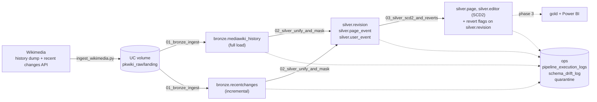

# Wikipedia Knowledge Integrity Lakehouse for Pakistan's Languages

A Spark / Delta Lake pipeline on Databricks that follows edits, new pages, deletions and reverts on
the Urdu, Punjabi (Shahmukhi), Sindhi and Pashto Wikipedias. Data goes through Bronze and Silver
layers (Gold and the Power BI dashboard come in Phase 3). This README covers Phase 2: the pipeline
itself, the data models, and how to run it.

**Team:** Zuraiz Anjum (23L-2547) · Zoraiz Rizwan (23L-6008)

## Phase 2 at a glance

What we built for this phase:

- PySpark code in `pipeline/` that does raw -> Bronze -> Silver, run from four Databricks notebooks
  and one Databricks job (`pkwiki-lakehouse-daily`). We use Databricks Free Edition (serverless,
  Unity Catalog).
- Explicit `StructType` schemas for every file we read and every table we write. No `inferSchema`
  anywhere. Silver casts with `try_cast`, and every row in every table has a `load_timestamp`.
- Every table write is a `MERGE INTO` (only the audit log is a plain append), so running the same
  day (or the same backfill) twice changes nothing.
- One set of parameters for everything: a normal daily run, a full load from a monthly dump, or a
  backfill of any date range / any subset of wikis.
- Schema drift doesn't crash the job. New fields are kept and logged, rows that don't fit are
  quarantined, and the schema can be evolved by adding the column to `pipeline/schemas.py`.
- An audit table (`ops.pipeline_execution_logs`) with one row per file / table per run, plus a
  schema drift log and a quarantine table.
- A local runner (`scripts/run_local.py`) so we can test the exact same code with open source
  Spark + Delta before using Databricks compute.

## Architecture



On Databricks everything lives in the `workspace` catalog, in four schemas:
`pkwiki_raw` (only holds the landing volume), `pkwiki_bronze`, `pkwiki_silver` and `pkwiki_ops`.
The `pkwiki` part is the `prefix` parameter, so we can make a throwaway copy (`pkwiki_test`) next
to the real one.

## Repository layout

| Path | What it is |
| --- | --- |
| `notebooks/00_setup.py` | Creates schemas, the landing volume and all tables. Can also copy the samples into the volume |
| `notebooks/01_bronze_ingest.py` | Raw files -> Bronze |
| `notebooks/02_silver_unify_and_mask.py` | Bronze -> Silver: cast, unify the two sources, mask PII, quarantine, MERGE |
| `notebooks/03_silver_scd2_and_reverts.py` | Revert detection for API edits, SCD Type 2 page and editor tables |
| `notebooks/99_checks.py` | Read-only queries to look at a run: execution logs, idempotency check, duplicate keys, quarantine / drift, row counts, MERGE history |
| `jobs/pkwiki_pipeline.json` | Job definition: bronze -> silver -> scd2, daily at 21:00 UTC (2 AM PKT), paused |
| `pipeline/schemas.py` | Every schema, written by hand, plus the table registry (partitions, primary keys) |
| `pipeline/runner.py` | Parameter handling, the entry points the notebooks call |
| `pipeline/bronze.py`, `silver.py`, `silver_history.py` | The actual transformations |
| `pipeline/audit.py` | Audit logging (`audit_step`) |
| `pipeline/pii.py`, `common/pii_policy.py` | PII masking (Spark version and plain Python version, same rules) |
| `pipeline/config.py`, `delta_utils.py`, `setup.py` | Table names, landing paths, MERGE helpers, table creation |
| `ingestion/ingest_wikimedia.py` | Extractor: downloads the dump (full) or calls the recent changes API (incremental) |
| `scripts/run_local.py` | Runs the pipeline on a laptop against `sample_data/` |
| `scripts/print_data_dictionary.py` | Prints the data dictionary below from `pipeline/schemas.py` |
| `sample_data/raw/` | PII-masked samples: dump snapshot 2026-08 (5,000 rows per wiki) and 24 hours of recent changes (27 Sep 2026) |
| `sample_data/drift_demo/` | Small broken / changed files we use to show the drift handling |
| `docs/phase1_proposal.pdf` | Phase 1 proposal |
| `dashboard/` | Phase 3 |

## How the pipeline works

There are two sources and they look nothing alike. The full load is the monthly MediaWiki history
dump (TSV, no header, 78 columns). The incremental load is the recent changes API, which the
extractor saves as JSON lines with a small envelope around each record (`_wiki`, `_source`,
`_ingested_at`, `_window_start`). Both land in the volume in the same folder layout as
`sample_data/raw`:

```
landing/mediawiki_history/load_type=full/snapshot=2026-08/wiki=urwiki/...
landing/recentchanges/load_type=incremental/ingest_date=2026-09-27/wiki=urwiki/...
```

### Bronze (`01_bronze_ingest`)

- Read with an explicit schema. The dump is read as 78 string columns (`HISTORY_RAW_SCHEMA`) in
  `PERMISSIVE` mode, so a line that doesn't split properly goes into `_corrupt_record` instead of
  failing the job. Each JSON line is first parsed with every field as a string, then each field
  is `try_cast` to its type in `RC_RECORD_SCHEMA`. A field that had a value before the cast and is
  null after it had the wrong type, so we know exactly which field broke.
- Nothing is cleaned. The only lines we drop are blank ones and exact duplicates within the same
  file batch. The original JSON line is kept in `raw_json`.
- We add lineage columns: `record_hash` (sha256 of the raw line), `source_file`, `snapshot` or
  `ingest_date`, `wiki`, `batch_id` (the run id) and `load_timestamp`.
- The write is an insert-only `MERGE` on `(partition, record_hash)`: a row is only inserted if that
  exact line isn't in the partition yet.
- Each wiki / day is its own step. If one wiki's file is broken the other wikis still load.

### Silver step 1 (`02_silver_unify_and_mask`)

- **Casting.** Every column is cast with `try_cast` (serverless runs with ANSI mode on, so a plain
  `cast` of a bad value would kill the job). The dump stores sha1 in base 36 and the API in hex, so
  we convert the dump's to hex to be able to compare them later.
- **Unifying the sources.** Both sources go into the same three tables: `silver.revision` (one row
  per edit), `silver.page_event` (creations, moves, deletions, restores, protections, ...) and
  `silver.user_event` (new accounts, renames, blocks, group changes). Titles are normalised (the
  API has the localized namespace prefix and spaces, the dump has neither). Timestamps are UTC, and
  we add a Pakistan time copy for the dashboard. Categorize events (category membership changes,
  about half the API feed) are skipped on purpose.
- **PII.** Editor names become `user_<hash>`, IPs `ip_<hash>`, temporary accounts `tmp_<hash>`
  (salted sha256, salt from the `pkwiki/pii_salt` secret). Bot and system accounts keep their
  names. User page titles are masked, and IPs, emails and user links in edit summaries are replaced.
  The rules are the same as in the Phase 1 proposal and live in `common/pii_policy.py`.
- **Quarantine.** A row goes to `ops.quarantine` (with a list of reasons and the raw line) instead
  of Silver when: the line was malformed or had a wrong type in Bronze, the wiki in the data doesn't
  match the folder, the timestamp doesn't parse, the revision id / page id / byte count isn't a
  number, an edit has no `revid`, a user log event has no `logid`, or the dump row has an unknown
  `event_entity`.
- **MERGE rules.** The primary key is `(wiki, rev_id)` for revisions and `(wiki, event_key)` for
  events. A matched row is only updated when its `row_hash` (hash of all the source attributes)
  changed. The dump wins over the API for the same revision, because it has the final revert and
  deletion flags, so an API row never overwrites a dump row.
- **Monthly handover.** The dump is rebuilt from scratch every month (Wikimedia warns against
  stitching dumps together). So a full load of snapshot `2026-08` takes over everything before
  2026-09-01 for the wikis in that run: API rows the dump also has get the dump version, and API
  rows before the cutoff that the dump doesn't have are deleted (`WHEN NOT MATCHED BY SOURCE ...
  DELETE`). API rows after the cutoff are kept. This is the only place the pipeline deletes rows.
  Deleted pages are never removed, they get `is_deleted = true`.
- **event_key.** Events with a log id use `log:<log_id>:<event_type>`. We first used just the log
  id, but found that the dump writes a page move that leaves a redirect as two rows (a `move` and a
  `create`) with the same log id. Events without a log id get `h:<hash of the row>`.

### Silver step 2 (`03_silver_scd2_and_reverts`)

- **Reverts.** The dump already tells us which edits were reverted. The API doesn't, so for API
  edits we check ourselves: if an edit has the same sha1 as one of the previous 15 versions of the
  page (looking back 30 days), it restored that version, and every edit in between gets
  `is_reverted = true`, `reverted_by_rev_id` and `seconds_to_revert`. (Step 1 already sets the flags
  from the `mw-rollback`, `mw-undo`, `mw-manual-revert` and `mw-reverted` tags, this catches the
  reverts that weren't tagged.) Flags only ever go from false to true.
- **SCD Type 2.** `silver.page` tracks title, namespace, redirect and deleted. `silver.editor`
  tracks editor type and bot status. A new version is only added when the tracked attributes
  actually change (`attr_hash`). The old version is closed (`valid_to`, `is_current = false`),
  never overwritten. It's the usual staged MERGE: changed keys go in twice, once to close the
  current row and once to insert the new one.

## Idempotency

Every table except the audit log is written with `MERGE INTO`, and every MERGE has a condition
that makes a repeat a no-op:

| Table | How a rerun is a no-op |
| --- | --- |
| bronze.* | insert only, matched on `(partition, record_hash)`. Same line = no insert |
| silver.revision / page_event / user_event | update only when `row_hash` changed, insert only new keys |
| silver.revision revert flags | flags only go false -> true |
| silver.page / silver.editor | new version only when `attr_hash` differs and the change is newer than the current version |
| ops.schema_drift_log, ops.quarantine | merged on their keys, nothing is logged twice |
| ops.pipeline_execution_logs | append only on purpose, every run should leave its own rows |

Duplicates inside one batch are removed before the MERGE (overlapping API windows can return the
same change twice). This is also why the standard daily run can safely re-read yesterday's folder.
We checked this by running everything twice, see [What we tested](#what-we-tested).

## Schema drift

We can't control what Wikimedia changes, so the rule is: keep the data, log it, quarantine what
doesn't fit, and never fail the whole run because of one bad file.

| What changes | What happens |
| --- | --- |
| New field in an API record (or in the envelope) | The row loads normally. The field is still in `raw_json`, its name is in `unknown_fields`, and a `new_field` row goes to `ops.schema_drift_log` |
| A field has a different type (e.g. text in `revid`) | `try_cast` gives null, the field name goes into `type_mismatch_fields`, the line goes into `_corrupt_record`, drift log gets `type_mismatch`. Silver quarantines that row ("wrong type for revid"). Other rows in the file load as normal |
| A line isn't valid JSON | Kept in Bronze with `record` null, drift log gets `malformed_json`, Silver quarantines it |
| The dump gets more or fewer than 78 columns | The reader can't split the line, so it lands in `_corrupt_record`. Drift log gets `column_count` (e.g. "79 fields instead of 78"), Silver quarantines the rows. Nothing crashes, but the whole snapshot sits in quarantine until we update `HISTORY_COLUMNS` |
| A bad value in a dump column | Becomes null after `try_cast`. If it's one we depend on (timestamp, revision id, page id, byte count, wiki) the row is quarantined, otherwise it just stays null |

To actually start loading a new field we add it to `pipeline/schemas.py`. On the next run
`evolve_schema()` compares the incoming DataFrame with the table and runs
`ALTER TABLE ... ADD COLUMNS` for anything missing, nested fields included (for example
`record.newfield`). That's basically `mergeSchema`, but done by hand because we write with MERGE.
Old Bronze rows were parsed with the old schema, so to fill the new column for past days we run
again with `bronze_mode=rebuild`, which deletes those Bronze partitions and re-reads the raw files.

Quarantined rows keep the raw line in `raw_payload`, so once the schema is fixed they can be replayed.

`sample_data/drift_demo/` has one small broken pswiki file per source with an example of each
case (its README lists which line does what). We run it into a throwaway prefix so the real tables
stay clean:

```bash
python scripts/run_local.py setup --prefix pkwiki_drift
python scripts/run_local.py all --prefix pkwiki_drift --landing_root sample_data/drift_demo --load_type incremental --start_date 2026-09-28 --wikis pswiki
python scripts/run_local.py all --prefix pkwiki_drift --landing_root sample_data/drift_demo --load_type full --snapshot 2026-08 --wikis pswiki
```

What came out of it:

| Broken input | What happened |
| --- | --- |
| New field `rc_quality_score` in an API record | Row loaded normally, field kept in `bronze.recentchanges.raw_json`, `new_field` entry in the drift log |
| `revid: "abc123"`, `oldlen: "big"` | `type_mismatch` entries for `revid` and `oldlen`, both rows quarantined (`wrong type for revid` / `oldlen`) |
| JSON line cut off halfway | `malformed_json` in the drift log, row quarantined |
| Two dump rows with a 79th column, one with only 40 | `column_count` entries ("79 fields instead of 78", "40 fields instead of 78"), 3 rows quarantined |
| `revision_id = not_a_number` | Quarantined as `bad revision_id` |

So 6 drift log rows and 7 quarantined rows, and the good rows from the same files (1 dump
revision, 3 API revisions, 2 page events) still made it into Silver. Every step finished SUCCESS.
Running it a second time added nothing to the drift log or the quarantine.

We also checked the "one table fails" case by dropping `silver.page_event` in the test copy. That
step was logged as FAILED, the other tables and the quarantine still loaded, and the notebook ended
with an error so the job would show red.

## Audit logging

Every unit of work runs inside `audit_step()` (`pipeline/audit.py`) and writes exactly one row to
`ops.pipeline_execution_logs`, whether it worked or not. A unit of work is one wiki partition into
Bronze, or one Silver table for the batch. So a normal daily run writes about 8 rows for Bronze
(4 wikis x 2 days), 4 for Silver step 1 and 3 for Silver step 2.

What each row has: `run_id` (shared by all steps of one job run), `layer` (`raw_to_bronze`,
`bronze_to_silver`, `silver_scd2`), `load_type`, `target_table`, `source_param` (the file path or
partition that was processed), `start_ts`, `end_ts`, `duration_sec`, `status`, `rows_read`,
`rows_inserted`, `rows_updated`, `rows_deleted`, `rows_quarantined`, `error_message` and
`params_json` (all parameters of the run). The insert / update / delete counts come straight from
the MERGE metrics.

- `SUCCESS`: the step finished.
- `SKIPPED`: nothing to do, for example no file landed for that wiki on that day.
- `FAILED`: the step threw an error. The message and a short traceback are in `error_message`.

Partial failures: in Bronze one wiki failing doesn't stop the others. The failed one gets a
`FAILED` row, the others still load, and at the end the notebook raises an error so the job run is
red and the Silver tasks don't start. In Silver the notebook stops at the first failed table.
Either way, fixing the problem and re-running the same parameters is safe because of the MERGEs.

To see what a run did:

```sql
SELECT layer, target_table, source_param, status, rows_read, rows_inserted, rows_updated,
       rows_deleted, rows_quarantined, duration_sec
FROM workspace.pkwiki_ops.pipeline_execution_logs
WHERE run_id = '<run id>'
ORDER BY start_ts;
```

## Data dictionary

Generated from `pipeline/schemas.py` with `python scripts/print_data_dictionary.py`, so it matches
the tables `00_setup` creates. On Databricks every name has the `workspace.` catalog in front
(e.g. `workspace.pkwiki_silver.revision`). "Null = no" columns are created `NOT NULL`, which Delta
enforces. The primary keys are also added as Unity Catalog `PRIMARY KEY` constraints, which are
informational (not enforced), the MERGEs are what keep them unique. Every table has
`load_timestamp`.

### Bronze

#### pkwiki_bronze.mediawiki_history

Full load. One row per line of the MediaWiki history dump, all 78 fields kept as text.

Partitioned by `snapshot`, `wiki`. Primary key: `snapshot`, `wiki`, `record_hash`.

| Column | Type | Null | Key | Description |
| --- | --- | --- | --- | --- |
| `wiki_db` ... `revision_tags` (78 columns) | `string` | yes | | the dump fields in source order, read as raw text. Cast in silver, full list with target types below |
| `_corrupt_record` | `string` | yes |  | whole line when it doesn't have exactly 78 fields |
| `record_hash` | `string` | no | PK | sha256 of the raw line, used to make bronze inserts idempotent |
| `source_file` | `string` | yes |  | file the row came from |
| `snapshot` | `string` | no | PK | dump month YYYY-MM (partition) |
| `wiki` | `string` | no | PK | wiki folder the file was in (partition) |
| `batch_id` | `string` | yes |  | run id that loaded the row |
| `load_timestamp` | `timestamp` | no |  | when this row was written to bronze |

<details>
<summary>All 78 dump columns, in file order, with the type silver casts them to (when silver uses them)</summary>

| # | Column | Typed as |
| --- | --- | --- |
| 1 | `wiki_db` | `string` |
| 2 | `event_log_id` | `bigint` |
| 3 | `event_entity` | `string` |
| 4 | `event_type` | `string` |
| 5 | `event_timestamp` | `timestamp` |
| 6 | `event_comment` | `string` |
| 7 | `event_user_id` | `bigint` |
| 8 | `event_user_central_id` | `bigint` |
| 9 | `event_user_text_historical` | `string` |
| 10 | `event_user_text` | `string` |
| 11 | `event_user_blocks_historical` | `array<string>` |
| 12 | `event_user_blocks` | `array<string>` |
| 13 | `event_user_groups_historical` | `array<string>` |
| 14 | `event_user_groups` | `array<string>` |
| 15 | `event_user_is_bot_by_historical` | `array<string>` |
| 16 | `event_user_is_bot_by` | `array<string>` |
| 17 | `event_user_is_created_by_self` | `boolean` |
| 18 | `event_user_is_created_by_system` | `boolean` |
| 19 | `event_user_is_created_by_peer` | `boolean` |
| 20 | `event_user_is_anonymous` | `boolean` |
| 21 | `event_user_is_temporary` | `boolean` |
| 22 | `event_user_is_permanent` | `boolean` |
| 23 | `event_user_is_cross_wiki` | `boolean` |
| 24 | `event_user_registration_timestamp` | `timestamp` |
| 25 | `event_user_creation_timestamp` | `timestamp` |
| 26 | `event_user_first_edit_timestamp` | `timestamp` |
| 27 | `event_user_revision_count` | `bigint` |
| 28 | `event_user_seconds_since_previous_revision` | `bigint` |
| 29 | `page_id` | `bigint` |
| 30 | `page_title_historical` | `string` |
| 31 | `page_title` | `string` |
| 32 | `page_namespace_historical` | `int` |
| 33 | `page_namespace_is_content_historical` | `boolean` |
| 34 | `page_namespace` | `int` |
| 35 | `page_namespace_is_content` | `boolean` |
| 36 | `page_is_redirect` | `boolean` |
| 37 | `page_is_deleted` | `boolean` |
| 38 | `page_creation_timestamp` | `timestamp` |
| 39 | `page_first_edit_timestamp` | `timestamp` |
| 40 | `page_revision_count` | `bigint` |
| 41 | `page_seconds_since_previous_revision` | `bigint` |
| 42 | `user_id` | `bigint` |
| 43 | `user_central_id` | `bigint` |
| 44 | `user_text_historical` | `string` |
| 45 | `user_text` | `string` |
| 46 | `user_blocks_historical` | `array<string>` |
| 47 | `user_blocks` | `array<string>` |
| 48 | `user_groups_historical` | `array<string>` |
| 49 | `user_groups` | `array<string>` |
| 50 | `user_is_bot_by_historical` | `array<string>` |
| 51 | `user_is_bot_by` | `array<string>` |
| 52 | `user_is_created_by_self` | `boolean` |
| 53 | `user_is_created_by_system` | `boolean` |
| 54 | `user_is_created_by_peer` | `boolean` |
| 55 | `user_is_anonymous` | `boolean` |
| 56 | `user_is_temporary` | `boolean` |
| 57 | `user_is_permanent` | `boolean` |
| 58 | `user_registration_timestamp` | `timestamp` |
| 59 | `user_creation_timestamp` | `timestamp` |
| 60 | `user_first_edit_timestamp` | `timestamp` |
| 61 | `revision_id` | `bigint` |
| 62 | `revision_parent_id` | `bigint` |
| 63 | `revision_minor_edit` | `boolean` |
| 64 | `revision_deleted_parts` | `array<string>` |
| 65 | `revision_deleted_parts_are_suppressed` | `boolean` |
| 66 | `revision_text_bytes` | `bigint` |
| 67 | `revision_text_bytes_diff` | `bigint` |
| 68 | `revision_text_sha1` | `string` |
| 69 | `revision_content_model` | `string` |
| 70 | `revision_content_format` | `string` |
| 71 | `revision_is_deleted_by_page_deletion` | `boolean` |
| 72 | `revision_deleted_by_page_deletion_timestamp` | `timestamp` |
| 73 | `revision_is_identity_reverted` | `boolean` |
| 74 | `revision_first_identity_reverting_revision_id` | `bigint` |
| 75 | `revision_seconds_to_identity_revert` | `bigint` |
| 76 | `revision_is_identity_revert` | `boolean` |
| 77 | `revision_is_from_before_page_creation` | `boolean` |
| 78 | `revision_tags` | `array<string>` |

</details>

#### pkwiki_bronze.recentchanges

Incremental load. One row per line of the recent changes jsonl files, record parsed with our declared types, original line kept in raw_json.

Partitioned by `ingest_date`, `wiki`. Primary key: `ingest_date`, `wiki`, `record_hash`.

| Column | Type | Null | Key | Description |
| --- | --- | --- | --- | --- |
| `env_wiki` | `string` | yes |  | _wiki from the envelope |
| `source_api` | `string` | yes |  | api endpoint the record came from |
| `ingested_at` | `string` | yes |  | when the extractor fetched it (raw string) |
| `window_start` | `string` | yes |  | watermark the extractor started from |
| `record` | `struct` | yes |  | the api record with our explicit types |
| `record.type` | `string` | yes |  | edit \| new \| log \| categorize |
| `record.ns` | `int` | yes |  | namespace number |
| `record.title` | `string` | yes |  | page title with localized namespace prefix |
| `record.pageid` | `bigint` | yes |  | page id |
| `record.revid` | `bigint` | yes |  | revision id of this edit (0 for log events) |
| `record.old_revid` | `bigint` | yes |  | previous revision of the page |
| `record.rcid` | `bigint` | yes |  | recent changes id |
| `record.user` | `string` | yes |  | editor name (masked in samples) |
| `record.userid` | `bigint` | yes |  | editor's user id (0 for logged out) |
| `record.bot` | `boolean` | yes |  | edit was flagged as a bot edit |
| `record.new` | `boolean` | yes |  | edit created the page |
| `record.minor` | `boolean` | yes |  | marked as a minor edit |
| `record.anon` | `boolean` | yes |  | logged out IP edit (pre temporary accounts) |
| `record.temp` | `boolean` | yes |  | temporary account |
| `record.oldlen` | `bigint` | yes |  | page size in bytes before |
| `record.newlen` | `bigint` | yes |  | page size in bytes after |
| `record.timestamp` | `string` | yes |  | ISO-8601 UTC, e.g. 2026-09-27T08:24:57Z |
| `record.comment` | `string` | yes |  | edit summary (raw in bronze, masked in silver) |
| `record.redirect` | `boolean` | yes |  | page is a redirect |
| `record.tags` | `array<string>` | yes |  | change tags, e.g. mw-undo, mw-reverted |
| `record.sha1` | `string` | yes |  | hex sha1 of the revision text |
| `record.logid` | `bigint` | yes |  | log entry id (log events only) |
| `record.logtype` | `string` | yes |  | move, delete, block, newusers, ... |
| `record.logaction` | `string` | yes |  | action within the log type, e.g. delete / restore |
| `record.logparams` | `map<string,string>` | yes |  | varies by log type, nested values kept as json text |
| `raw_json` | `string` | yes |  | the original line, nothing dropped (new fields survive here) |
| `_corrupt_record` | `string` | yes |  | set when the line isn't valid json or a field has the wrong type |
| `type_mismatch_fields` | `array<string>` | yes |  | fields whose value didn't fit the declared type |
| `unknown_fields` | `array<string>` | yes |  | fields in the json that aren't in our schema yet |
| `record_hash` | `string` | no | PK | sha256 of the raw line |
| `source_file` | `string` | yes |  | file the row came from |
| `ingest_date` | `string` | no | PK | YYYY-MM-DD folder (partition) |
| `wiki` | `string` | no | PK | wiki folder (partition) |
| `batch_id` | `string` | yes |  | run id that last wrote the row |
| `load_timestamp` | `timestamp` | no |  | when this row was written to bronze |

### Silver

#### pkwiki_silver.revision

One row per edit, from both sources. Cast, masked and deduplicated.

Partitioned by `wiki`. Primary key: `wiki`, `rev_id`.

| Column | Type | Null | Key | Description |
| --- | --- | --- | --- | --- |
| `wiki` | `string` | no | PK | urwiki, pnbwiki, sdwiki, pswiki |
| `rev_id` | `bigint` | no | PK | revision id (PK with wiki) |
| `page_id` | `bigint` | yes |  | MediaWiki page id |
| `parent_rev_id` | `bigint` | yes |  | previous revision of the page, 0 for page creation |
| `rev_ts` | `timestamp` | no |  | edit time UTC |
| `rev_ts_pkt` | `timestamp` | yes |  | edit time in Pakistan time, for the dashboard |
| `rev_date` | `date` | yes |  | UTC date of rev_ts |
| `page_title` | `string` | yes |  | title at the time of the edit, no namespace prefix, user pages masked |
| `page_namespace` | `int` | yes |  | namespace number (0 = articles) |
| `page_is_redirect` | `boolean` | yes |  | page was a redirect |
| `editor_key` | `string` | yes |  | salted hash of the editor (bot names kept) |
| `editor_type` | `string` | yes |  | registered \| temporary \| ip \| bot |
| `is_bot` | `boolean` | yes |  | edit made by a bot |
| `editor_registration_ts` | `timestamp` | yes |  | only known from the dump |
| `bytes` | `bigint` | yes |  | page size after the edit |
| `bytes_diff` | `bigint` | yes |  | size change in bytes |
| `sha1` | `string` | yes |  | hex sha1 of the text (dump base36 is converted) |
| `is_minor` | `boolean` | yes |  | marked as a minor edit |
| `is_page_creation` | `boolean` | yes |  | first revision of the page |
| `comment_masked` | `string` | yes |  | edit summary with IPs, emails and user links masked |
| `tags` | `array<string>` | yes |  | change tags |
| `is_revert` | `boolean` | yes |  | this edit restored an earlier version |
| `is_reverted` | `boolean` | yes |  | this edit was later undone |
| `reverted_by_rev_id` | `bigint` | yes |  | revision that undid this one |
| `seconds_to_revert` | `bigint` | yes |  | how long the edit survived |
| `is_deleted` | `boolean` | yes |  | page or revision deleted (soft delete, row is kept) |
| `source` | `string` | no |  | dump \| api |
| `source_ref` | `string` | yes |  | snapshot for dump rows, ingest_date for api rows |
| `row_hash` | `string` | yes |  | hash of the source attributes, MERGE only updates when it changes |
| `batch_id` | `string` | yes |  | run that last wrote the row |
| `load_timestamp` | `timestamp` | no |  | when silver last wrote this row |

#### pkwiki_silver.page_event

Page creations, moves, deletions, restores, protections, uploads, merges.

Partitioned by `wiki`. Primary key: `wiki`, `event_key`.

| Column | Type | Null | Key | Description |
| --- | --- | --- | --- | --- |
| `wiki` | `string` | no | PK | urwiki, pnbwiki, sdwiki, pswiki |
| `event_key` | `string` | no | PK | log:&lt;log_id&gt;:&lt;event_type&gt; when there is a log id, otherwise h:&lt;hash&gt; (PK with wiki) |
| `log_id` | `bigint` | yes |  | MediaWiki log id |
| `page_id` | `bigint` | yes |  | MediaWiki page id |
| `event_type` | `string` | yes |  | create \| move \| delete \| restore \| protect \| upload \| merge \| other:* |
| `event_ts` | `timestamp` | no |  | event time UTC |
| `event_ts_pkt` | `timestamp` | yes |  | event time in Pakistan time |
| `page_namespace` | `int` | yes |  | namespace number (0 = articles) |
| `page_title` | `string` | yes |  | title the event happened on |
| `new_title` | `string` | yes |  | target title for moves |
| `editor_key` | `string` | yes |  | salted hash of the editor (bot names kept) |
| `editor_type` | `string` | yes |  | registered \| temporary \| ip \| bot |
| `comment_masked` | `string` | yes |  | edit / log summary with IPs, emails and user links masked |
| `source` | `string` | no |  | dump \| api |
| `source_ref` | `string` | yes |  | snapshot for dump rows, ingest_date for api rows |
| `row_hash` | `string` | yes |  | hash of the source attributes, MERGE only updates when it changes |
| `batch_id` | `string` | yes |  | run id that last wrote the row |
| `load_timestamp` | `timestamp` | no |  | when this row was written |

#### pkwiki_silver.user_event

Account creations, renames, blocks, unblocks and group changes.

Partitioned by `wiki`. Primary key: `wiki`, `event_key`.

| Column | Type | Null | Key | Description |
| --- | --- | --- | --- | --- |
| `wiki` | `string` | no | PK | urwiki, pnbwiki, sdwiki, pswiki |
| `event_key` | `string` | no | PK | log:&lt;log_id&gt;:&lt;event_type&gt; or h:&lt;hash&gt; (PK with wiki) |
| `log_id` | `bigint` | yes |  | MediaWiki log id |
| `event_type` | `string` | yes |  | create \| rename \| block \| unblock \| altergroups \| alterblocks |
| `event_ts` | `timestamp` | no |  | event time UTC |
| `event_ts_pkt` | `timestamp` | yes |  | event time in Pakistan time |
| `performer_key` | `string` | yes |  | who did it (hashed) |
| `performer_type` | `string` | yes |  | registered \| temporary \| ip \| bot |
| `target_key` | `string` | yes |  | account it was done to (hashed) |
| `target_type` | `string` | yes |  | registered \| temporary \| ip \| bot |
| `block_duration` | `string` | yes |  | as given by the api, e.g. '1 week', 'infinity' |
| `block_flags` | `array<string>` | yes |  | block options, e.g. nocreate, noautoblock |
| `user_groups` | `array<string>` | yes |  | groups after the change |
| `comment_masked` | `string` | yes |  | edit / log summary with IPs, emails and user links masked |
| `source` | `string` | no |  | dump \| api |
| `source_ref` | `string` | yes |  | snapshot for dump rows, ingest_date for api rows |
| `row_hash` | `string` | yes |  | hash of the source attributes, MERGE only updates when it changes |
| `batch_id` | `string` | yes |  | run id that last wrote the row |
| `load_timestamp` | `timestamp` | no |  | when this row was written |

#### pkwiki_silver.page

SCD Type 2 page dimension (title, namespace, redirect, deleted). One row per version.

Partitioned by `wiki`. Primary key: `page_sk`.

| Column | Type | Null | Key | Description |
| --- | --- | --- | --- | --- |
| `page_sk` | `string` | no | PK | surrogate key, one per version |
| `wiki` | `string` | no |  | urwiki, pnbwiki, sdwiki, pswiki |
| `page_id` | `bigint` | no |  | MediaWiki page id |
| `page_title` | `string` | yes |  | title in this version |
| `page_namespace` | `int` | yes |  | namespace number (0 = articles) |
| `is_redirect` | `boolean` | yes |  | redirect in this version |
| `is_deleted` | `boolean` | yes |  | deleted in this version |
| `attr_hash` | `string` | yes |  | hash of the tracked attributes |
| `valid_from` | `timestamp` | no |  | when this version started |
| `valid_to` | `timestamp` | yes |  | null while current |
| `is_current` | `boolean` | no |  | true for the latest version |
| `batch_id` | `string` | yes |  | run id that last wrote the row |
| `load_timestamp` | `timestamp` | no |  | when this row was written |

#### pkwiki_silver.editor

SCD Type 2 editor dimension (editor_type, is_bot). One row per version.

Partitioned by `wiki`. Primary key: `editor_sk`.

| Column | Type | Null | Key | Description |
| --- | --- | --- | --- | --- |
| `editor_sk` | `string` | no | PK | surrogate key, one per version |
| `wiki` | `string` | no |  | urwiki, pnbwiki, sdwiki, pswiki |
| `editor_key` | `string` | no |  | salted hash of the editor (bot names kept) |
| `editor_type` | `string` | yes |  | registered \| temporary \| ip \| bot |
| `is_bot` | `boolean` | yes |  | bot account (name kept unhashed) |
| `registration_ts` | `timestamp` | yes |  | from the dump, null for api-only editors |
| `attr_hash` | `string` | yes |  | hash of the tracked attributes |
| `valid_from` | `timestamp` | no |  | first edit seen in this state |
| `valid_to` | `timestamp` | yes |  | when it was replaced, null while current |
| `is_current` | `boolean` | no |  | true for the latest version |
| `batch_id` | `string` | yes |  | run id that last wrote the row |
| `load_timestamp` | `timestamp` | no |  | when this row was written |

### Ops (audit, drift, quarantine)

#### pkwiki_ops.pipeline_execution_logs

Audit log. One row per unit of work (file/partition or table) per run.

Not partitioned. Primary key: `log_id`.

| Column | Type | Null | Key | Description |
| --- | --- | --- | --- | --- |
| `log_id` | `string` | no | PK | random id of the log row |
| `run_id` | `string` | yes |  | job run id, shared by all steps of one run |
| `layer` | `string` | yes |  | raw_to_bronze \| bronze_to_silver \| silver_scd2 |
| `load_type` | `string` | yes |  | full \| incremental |
| `target_table` | `string` | yes |  | table written by the step |
| `source_param` | `string` | yes |  | file path / partition / parameter that was processed |
| `start_ts` | `timestamp` | yes |  | step start (UTC) |
| `end_ts` | `timestamp` | yes |  | step end (UTC) |
| `duration_sec` | `double` | yes |  | end_ts - start_ts in seconds |
| `status` | `string` | yes |  | SUCCESS \| FAILED \| SKIPPED |
| `rows_read` | `bigint` | yes |  | rows the step read from its source |
| `rows_inserted` | `bigint` | yes |  | rows inserted by the MERGE |
| `rows_updated` | `bigint` | yes |  | rows updated by the MERGE |
| `rows_deleted` | `bigint` | yes |  | rows deleted by the MERGE (monthly handover only) |
| `rows_quarantined` | `bigint` | yes |  | rows sent to ops.quarantine |
| `error_message` | `string` | yes |  | exception and short traceback when FAILED, reason when SKIPPED |
| `params_json` | `string` | yes |  | all notebook parameters for this run |
| `load_timestamp` | `timestamp` | no |  | when this row was written |

#### pkwiki_ops.schema_drift_log

Every schema drift we noticed, one row per field per batch.

Not partitioned. Primary key: `source`, `batch_ref`, `wiki`, `drift_type`, `field_name`.

| Column | Type | Null | Key | Description |
| --- | --- | --- | --- | --- |
| `source` | `string` | no | PK | mediawiki_history \| recentchanges |
| `batch_ref` | `string` | no | PK | snapshot or ingest_date |
| `wiki` | `string` | no | PK | urwiki, pnbwiki, sdwiki, pswiki |
| `drift_type` | `string` | no | PK | new_field \| type_mismatch \| column_count |
| `field_name` | `string` | no | PK | field name, or the column count for column_count drift |
| `row_count` | `bigint` | yes |  | rows affected in that batch |
| `sample_value` | `string` | yes |  | first 300 chars of one affected line |
| `action_taken` | `string` | yes |  | what the pipeline did about it |
| `first_seen_run_id` | `string` | yes |  | run that first logged it |
| `load_timestamp` | `timestamp` | no |  | when this row was written |

#### pkwiki_ops.quarantine

Rows that failed a silver check, with the reasons and the raw line so they can be replayed.

Partitioned by `source_table`. Primary key: `source_table`, `record_hash`.

| Column | Type | Null | Key | Description |
| --- | --- | --- | --- | --- |
| `source_table` | `string` | no | PK | bronze table the row came from |
| `record_hash` | `string` | no | PK | record_hash of the bronze row |
| `wiki` | `string` | yes |  | wiki folder of the bronze row |
| `batch_ref` | `string` | yes |  | snapshot or ingest_date of the bronze row |
| `reasons` | `array<string>` | yes |  | why it was rejected |
| `raw_payload` | `string` | yes |  | the raw line, so it can be fixed and replayed |
| `batch_id` | `string` | yes |  | run id that last wrote the row |
| `load_timestamp` | `timestamp` | no |  | when this row was written |

## Execution guide

### One-time setup on Databricks Free Edition

1. **Git folder.** Workspace > Create > Git folder, paste the repo URL. The notebooks import
   `pipeline/` from the repo, so when we run them by hand they need to be opened from inside the
   Git folder. (The job doesn't need this, it checks out the repo from GitHub itself.)
2. **PII salt secret.** With the Databricks CLI:
   ```bash
   databricks secrets create-scope pkwiki
   databricks secrets put-secret pkwiki pii_salt
   ```
   The second command asks for the value. Use a long random string and don't change it later,
   otherwise the same editor gets a different `editor_key`.
3. **Run `notebooks/00_setup`** with `catalog=workspace`, `prefix=pkwiki`. Set `seed_samples=yes`
   the first time if you want the sample files copied into the landing volume. It's safe to run
   again, existing tables are left alone.
4. **Land data.** The extractor runs outside Databricks for now. Its output folder has the same
   layout as the volume, so we copy it over:
   ```bash
   python ingestion/ingest_wikimedia.py incremental --out out/
   databricks fs cp -r out/ dbfs:/Volumes/workspace/pkwiki_raw/landing --overwrite
   ```
   The extractor carries on from its saved watermark. To pull days we never fetched, pass
   `--start 2026-09-20` (the recent changes API only keeps about 30 days, older gaps have to come
   from the next monthly dump).
5. **Job.** The job in `jobs/pkwiki_pipeline.json` runs the notebooks straight from GitHub
   (`git_source` points at https://github.com/zuraiz-anjum/pk-wiki-integrity-lakehouse, branch
   `main`), so whatever is pushed to `main` is what runs. Then:
   ```bash
   databricks jobs create --json @jobs/pkwiki_pipeline.json
   ```
   It has three tasks (`bronze` -> `silver` -> `scd2`), runs at most one run at a time, and is
   scheduled for 21:00 UTC (2 AM PKT) but created paused. Unpause the schedule when you want it to
   run every day.

### Parameters

The notebooks have widgets and the job has job parameters with the same names. Everything is a
string, an empty value means the default.

| Parameter | Values | Default | Meaning |
| --- | --- | --- | --- |
| `load_type` | `full` / `incremental` | `incremental` | `full` reads the history dump, `incremental` reads recent changes |
| `snapshot` | `YYYY-MM` | | Which dump to load. Required for `full` |
| `start_date` | `YYYY-MM-DD` | | First `ingest_date` folder to process (incremental) |
| `end_date` | `YYYY-MM-DD` | same as `start_date` | Last one, inclusive. At most a year per run |
| `wikis` | `all` or a list like `urwiki,sdwiki` | `all` | Which wikis to process |
| `bronze_mode` | `append` / `rebuild` | `append` | `rebuild` deletes the Bronze partitions in scope first and re-reads the raw files |
| `catalog` | | `workspace` | Unity Catalog catalog |
| `prefix` | | `pkwiki` | Schema prefix, e.g. `pkwiki_test` for a copy |
| `landing_root` | path | `/Volumes/<catalog>/<prefix>_raw/landing` | Where the raw files are. Empty means the default volume |
| `run_id` | | job run id, or `manual-<time>-<random>` | The job passes `{{job.run_id}}` so all three tasks share one id |

**Standard incremental vs backfill.** The only difference is the dates. With `start_date` and
`end_date` empty, the run is the standard daily one: it takes the two newest `ingest_date` folders
that have landed. Re-reading yesterday costs almost nothing (the MERGE inserts 0 rows) and it picks
up any file that landed after yesterday's run. With `start_date` set it's a backfill: exactly those
days, nothing else. Days with no files are logged as `SKIPPED`, not failed. A backfill only reads
what is already in the landing volume, so for days that were never extracted, run the extractor
with `--start` first (see step 4 above).

### Common scenarios

Anything not listed stays at its default.

| Scenario | Parameters |
| --- | --- |
| Standard daily incremental (what the schedule runs) | `load_type=incremental` |
| Full load / new monthly snapshot | `load_type=full`, `snapshot=2026-08` |
| Backfill a date range | `load_type=incremental`, `start_date=2026-09-20`, `end_date=2026-09-27` |
| Backfill a single day | `load_type=incremental`, `start_date=2026-09-27` |
| Backfill one wiki | `load_type=incremental`, `start_date=2026-09-20`, `end_date=2026-09-27`, `wikis=urwiki` |
| Reload one wiki from the dump | `load_type=full`, `snapshot=2026-08`, `wikis=urwiki` |
| Re-parse after adding a field to `schemas.py` | the same dates (or snapshot) as the original load, plus `bronze_mode=rebuild` |
| Test copy that doesn't touch the real tables | `prefix=pkwiki_test` (run `00_setup` with the same prefix first, with `seed_samples=yes` or point `landing_root` at the real volume) |

**From the notebooks:** open `01_bronze_ingest`, fill in the widgets and Run all, then do the same
in `02_silver_unify_and_mask` and `03_silver_scd2_and_reverts` with the same values. Each notebook
shows the audit rows of its run at the end. If you want the three notebooks under one `run_id`,
type the same value into the `run_id` widget in all three.

**From the job:** Run now with different parameters, or with the CLI / API. A backfill:

```json
{
  "job_id": 123456789,
  "job_parameters": {
    "load_type": "incremental",
    "start_date": "2026-09-20",
    "end_date": "2026-09-27",
    "wikis": "all"
  }
}
```

```bash
databricks jobs run-now --json @backfill.json
```

The standard daily run is the same call with only `"load_type": "incremental"` (or no parameters
at all), and a full load is `{"load_type": "full", "snapshot": "2026-08"}`.

## Running locally

We test changes on our laptops first so we don't burn the free tier compute. `scripts/run_local.py`
runs the same `pipeline/` code with open source Spark and Delta, against `sample_data/raw`. It
needs Java 17 (on Windows we use WSL).

```bash
python -m venv .venv && source .venv/bin/activate
pip install -r requirements-local.txt
export PII_SALT=anything-for-local

python scripts/run_local.py setup
python scripts/run_local.py all --load_type full --snapshot 2026-08
python scripts/run_local.py all --load_type incremental --start_date 2026-09-27
python scripts/run_local.py sql "select * from pkwiki_ops.pipeline_execution_logs"
```

`bronze`, `silver` and `scd2` run one step at a time, `all` runs the three in order. All the
parameters from the table above work as `--name value`. Tables are written to `.local/` (or
`$LOCAL_LAKEHOUSE`), delete it to start over.

## What we tested

Run locally on the samples:

| Run | Result |
| --- | --- |
| Full load, snapshot 2026-08 | Bronze 4 x 5,000 rows. Silver: 17,106 revisions, 2,671 page events, 223 user events, 0 quarantined |
| Incremental, 2026-09-27 | Bronze 17,405 rows (urwiki 17,045, sdwiki 350, pnbwiki 6, pswiki 4). Silver: 9,063 revisions, 1,396 page events, 7 user events. 8,311 categorize events skipped on purpose |
| Silver step 2 after the full load | SCD2: 2,714 page versions, 494 editor versions |
| Silver step 2 after the incremental | Revert detection filled in `reverted_by_rev_id` / `seconds_to_revert` for 16 API edits. SCD2: 6,448 new page versions, 1 page closed (renamed), 48 new editors |
| Full and incremental again (the incremental with no dates, i.e. a normal daily run) | Every step in every layer inserted 0, updated 0, deleted 0 rows |

The full load numbers add up: 17,106 + 2,671 + 223 = 20,000, so every dump row ended up in exactly
one Silver table. While building this we also found the move + redirect rows sharing a log id
(see `event_key` above). With only the log id in the key, the dedupe would have kept one of the
two rows and quietly dropped the other.

Checks we ran on the Silver tables after all of that (the same queries are in `99_checks`):

- no duplicate primary keys in any table, and exactly one `is_current` row per page / editor
- SCD2 history has no gaps or overlaps (`valid_to` of one version = `valid_from` of the next)
- every editor key is either a `user_` / `ip_` / `tmp_` hash or a bot / system account name, and no
  IP address is left in `comment_masked`
- 536 old dump rows have `rev_ts_pkt` 6 hours ahead of UTC instead of 5. We thought it was a bug,
  but they are all between June and October 2008, when Pakistan had daylight saving time.

### On Databricks

After the local runs we ran the same thing on our Databricks Free Edition workspace (serverless),
from the Git folder. `00_setup` created the 10 tables with their primary key constraints and
copied the samples into the volume. Then, straight from `ops.pipeline_execution_logs`:

| run_id | What | Steps | Status | Inserted | Updated | Deleted |
| --- | --- | --- | --- | --- | --- | --- |
| `dbx-full-1` | full load, snapshot 2026-08 | 10 | all SUCCESS | 43,208 | 0 | 0 |
| `dbx-incr-1` | incremental, `start_date=2026-09-27` | 11 | all SUCCESS | 34,367 | 17 | 0 |
| `dbx-full-2` | same full load again | 10 | all SUCCESS | 0 | 0 | 0 |
| `dbx-incr-2-standard` | incremental with no dates (normal daily run) | 11 | all SUCCESS | 0 | 0 | 0 |
| job run | `pkwiki-lakehouse-daily` started once by hand, code pulled from GitHub | 11 | all SUCCESS | 0 | 0 | 0 |

(Inserted counts every layer together, e.g. the full load is 20,000 bronze rows + 20,000 silver
rows + 3,208 SCD2 versions.) The row counts per table are the same as in the local runs. The drift
demo, run into `pkwiki_drift`, gave the same 6 drift log rows and 7 quarantined rows as locally.

## Cost and free tier notes

- Databricks Free Edition is serverless only and has a daily compute limit, so we keep runs small:
  the daily feed is around 17,000 events and 10-15 MB.
- The job is created paused. We only unpause it when we actually want daily loads.
- The real all-time dumps for the four wikis are around 0.5-1 GB compressed. If that turns out to
  be too much for the free tier, the fallback from our proposal still applies (Urdu only, from 2015
  on).
- Most testing happens locally (above), Databricks is for the real runs.

## Not done yet / Phase 3

- Gold layer and the Power BI dashboard.
- The DB-IP Lite country lookup for old IP edits from the proposal isn't implemented yet. Right
  now IPs are only hashed (`ip_<hash>`), so we have no country information.
- The extractor still runs on our laptop and keeps its watermark in `watermarks.json`. The files
  are copied into the volume by hand. Moving extraction into Databricks (a fourth job task) is next.
- Deleting raw files 30 days after processing (from the proposal) isn't automated yet.
- The numbers above are from the samples. Loading the real all-time dumps is the next big test.

## Changes since Phase 1

- Added the whole pipeline (`pipeline/`), the notebooks, the job and the local runner.
- Fixed a bug in the PII policy. The column positions for the dump's bot columns were off by one,
  and for the recent changes API we treated the edit's `bot` flag as meaning "bot account". That
  flag is also set for humans using the flood flag, so a few real usernames in the Phase 1 sample
  files weren't hashed. Now only accounts with "bot" in the name (Wikipedia requires that for bot
  accounts) and a few system accounts keep their names. The sample files were re-masked with
  the fixed policy.
