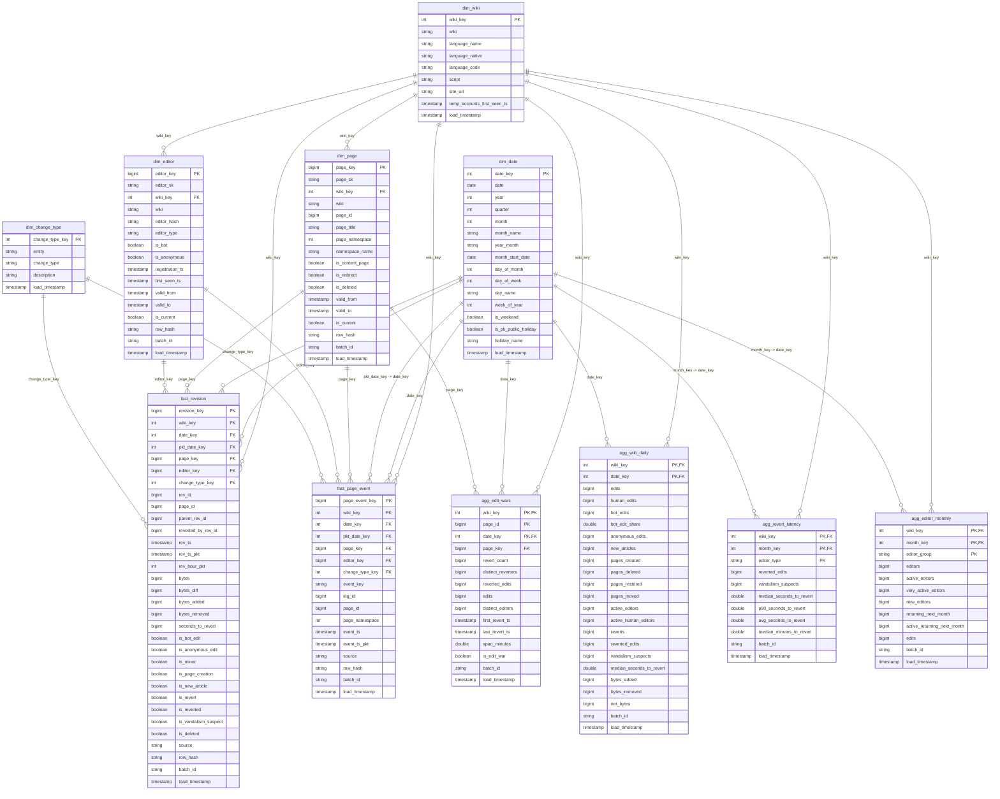

# Gold data dictionary

The Gold layer is a star schema in the `pkwiki_gold` schema (`workspace.pkwiki_gold.*` on
Databricks). It is what the Power BI report reads. Silver keeps one cleaned copy of everything;
Gold reshapes it into dimensions and facts with surrogate keys, and adds four aggregate facts for
the heavier numbers so the report stays fast.

- 5 dimensions: `dim_date`, `dim_wiki`, `dim_change_type`, `dim_page` (SCD2), `dim_editor` (SCD2)
- 2 event facts: `fact_revision` (one row per edit), `fact_page_event` (one row per page log event)
- 4 aggregate facts: `agg_wiki_daily`, `agg_revert_latency`, `agg_edit_wars`, `agg_editor_monthly`
- 1 bookkeeping table in ops: `pkwiki_ops.gold_watermark`

The column tables at the bottom are generated from `pipeline/schemas.py` with
`python scripts/print_data_dictionary.py --layer gold`, so they match what the pipeline creates.
The PNG version of the diagram is `docs/gold_er_diagram.png` (`python scripts/draw_gold_er.py`).

## Keys

- **Surrogate keys.** `page_key`, `editor_key`, `revision_key` and `page_event_key` are `bigint`
  values computed as `xxhash64` of the natural key (`page_sk`, `editor_sk`, `wiki|rev_id`,
  `wiki|event_key`), with the sign bit cleared so a real key is never negative (negative keys are
  kept for the unknown members). The same row always gets the same key, so reruns and MERGEs never renumber
  anything and facts can be loaded without a key lookup table.
- **Small fixed keys.** `wiki_key` (1 urwiki, 2 pnbwiki, 3 sdwiki, 4 pswiki) and `change_type_key`
  (1 to 4 for revisions, 11 to 18 for page events).
- **Date keys.** `date_key` is `yyyymmdd` as an `int`. `month_key` is the `date_key` of the first
  day of the month, so monthly tables join to `dim_date` too. `pkt_date_key` is the same edit or
  event on the Pakistan calendar (UTC+5), a second, role playing link to `dim_date`.
- **Unknown members.** If a fact can't find its page or editor version it points at the unknown
  member of its own wiki, key `-wiki_key` (-1 to -4). Those rows exist in `dim_page` and
  `dim_editor`, so every FK resolves and the wiki filter still works.
- **PK / FK in Unity Catalog.** On Databricks every PK and FK below is added as an informational
  constraint (not enforced, but the catalog explorer and Power BI pick up the relationships). The
  key columns are `NOT NULL`, which Delta does enforce. The MERGEs are what keep the keys unique.

## PII

Gold never sees a raw username or IP. Editors are only known by `editor_hash`, the salted hash
Silver made (`user_<hash>`, `ip_<hash>`, `tmp_<hash>`). Bot and system accounts keep their public
names. Edit summaries are not copied to Gold at all, and user page titles were already masked in
Silver.

## Which table answers which question

| Question (Phase 1) | Tables |
| --- | --- |
| Q1 Are the wikis growing, in new articles and active editors? | `agg_wiki_daily` (new_articles, active_editors), `agg_editor_monthly` (active, new and returning editors), `fact_page_event` (deletions) |
| Q2 How fast is vandalism undone, by editor type? | `agg_revert_latency` (median and p90 time to revert), `fact_revision` (seconds_to_revert, is_vandalism_suspect) + `dim_editor.editor_type` |
| Q3 Which pages are fought over most, and what are they? | `agg_edit_wars` + `dim_page` (title, namespace). The table keeps every page-day with 2+ reverts; the Phase 1 rule (3+ reverts by 2+ editors) left too few rows for a leaderboard on our data, so it is the `is_edit_war` flag instead of the filter |
| Q4 How much is written by bots? | `agg_wiki_daily` (bot_edits, bot_edit_share), `agg_editor_monthly` (editor_group), `fact_revision.is_bot_edit` |
| Q5 Did anonymous editing or vandalism change with temporary accounts? | `fact_revision` (is_anonymous_edit, is_vandalism_suspect) + `dim_wiki.temp_accounts_first_seen_ts`, `agg_wiki_daily` (anonymous_edits), `agg_revert_latency` by editor type |
| Heat map by hour and weekday (Pakistan time) | `fact_revision.rev_hour_pkt` + `pkt_date_key` -> `dim_date.day_of_week` |

## Grain and refresh

| Table | Grain | Refresh |
| --- | --- | --- |
| `dim_date` | one row per day, 2001-01-01 to 2030-12-31 | generated, MERGE inserts missing days (a rerun changes nothing) |
| `dim_wiki` | one row per wiki | static list MERGEd, `temp_accounts_first_seen_ts` updated in place |
| `dim_change_type` | one row per kind of change | static list MERGEd |
| `dim_page` | one row per page version + 4 unknown rows | MERGE of the silver.page rows written since the last run (closed versions get their `valid_to`) |
| `dim_editor` | one row per editor version + 4 unknown rows | same, from silver.editor |
| `fact_revision` | one row per edit | MERGE of the silver.revision rows written since the last run; full load also deletes rows Silver deleted |
| `fact_page_event` | one row per page log event | same, from silver.page_event |
| `agg_wiki_daily` | wiki x day | recomputed for the days whose facts changed, MERGE, empty groups deleted |
| `agg_revert_latency` | wiki x month x editor type | recomputed for the months whose facts changed |
| `agg_edit_wars` | page x day, only page-days with 2+ reverts (`is_edit_war` = 3+ reverts by 2+ editors) | recomputed for the changed days, page-days that no longer qualify are deleted |
| `agg_editor_monthly` | wiki x month x human/bot | recomputed for all months (new / returning editors depend on other months), only changed rows are written |

## ER diagram

`||--o{` is "one to many". Every fact and aggregate links to `dim_wiki`; the arrows below list
each FK column.

## Tables

### pkwiki_gold.dim_date

Calendar dimension, one row per day from 2001-01-01 to 2030-12-31.

Not partitioned. Primary key: `date_key`.

| Column | Type | Null | Key | Description |
| --- | --- | --- | --- | --- |
| `date_key` | `int` | no | PK | yyyymmdd, e.g. 20260927 |
| `date` | `date` | no |  | calendar day |
| `year` | `int` | yes |  |  |
| `quarter` | `int` | yes |  |  |
| `month` | `int` | yes |  |  |
| `month_name` | `string` | yes |  | January ... December |
| `year_month` | `string` | yes |  | YYYY-MM |
| `month_start_date` | `date` | yes |  | first day of the month |
| `day_of_month` | `int` | yes |  |  |
| `day_of_week` | `int` | yes |  | 1 = Monday ... 7 = Sunday |
| `day_name` | `string` | yes |  | Monday ... Sunday |
| `week_of_year` | `int` | yes |  | ISO week |
| `is_weekend` | `boolean` | yes |  | Saturday or Sunday |
| `is_pk_public_holiday` | `boolean` | yes |  | fixed-date Pakistani public holiday (Eid and other lunar holidays not included) |
| `holiday_name` | `string` | yes |  | name of the holiday, null on normal days |
| `load_timestamp` | `timestamp` | no |  | when this row was written |

### pkwiki_gold.dim_wiki

One row per wiki: language, script and when temporary accounts first show up in the data.

Not partitioned. Primary key: `wiki_key`.

| Column | Type | Null | Key | Description |
| --- | --- | --- | --- | --- |
| `wiki_key` | `int` | no | PK | small fixed code, 1 to 4 |
| `wiki` | `string` | no |  | urwiki, pnbwiki, sdwiki, pswiki |
| `language_name` | `string` | yes |  | Urdu, Punjabi (Shahmukhi), Sindhi, Pashto |
| `language_native` | `string` | yes |  | language name in its own script |
| `language_code` | `string` | yes |  | ur, pnb, sd, ps |
| `script` | `string` | yes |  | writing system |
| `site_url` | `string` | yes |  |  |
| `temp_accounts_first_seen_ts` | `timestamp` | yes |  | first edit by a temporary account we have for this wiki (rollout as seen in the data) |
| `load_timestamp` | `timestamp` | no |  | when this row was last written |

### pkwiki_gold.dim_page

SCD Type 2 page dimension, one row per version of a page (from silver.page) plus one unknown page per wiki (key -1 to -4).

Not partitioned, clustered by `wiki_key`, `page_id`. Primary key: `page_key`.

| Column | Type | Null | Key | Description |
| --- | --- | --- | --- | --- |
| `page_key` | `bigint` | no | PK | surrogate key, xxhash64 of page_sk (always &gt;= 0), -1 to -4 = unknown page of wiki 1 to 4 |
| `page_sk` | `string` | no |  | silver.page key of this version (lineage) |
| `wiki_key` | `int` | no | FK dim_wiki.wiki_key | which wiki |
| `wiki` | `string` | no |  | urwiki, pnbwiki, sdwiki, pswiki |
| `page_id` | `bigint` | no |  | MediaWiki page id |
| `page_title` | `string` | yes |  | title in this version (user pages masked) |
| `page_namespace` | `int` | yes |  | namespace number |
| `namespace_name` | `string` | yes |  | Article, Talk, User, Project, File, Template, Help, Category, Portal, Other |
| `is_content_page` | `boolean` | yes |  | namespace 0 (articles) |
| `is_redirect` | `boolean` | yes |  | redirect in this version |
| `is_deleted` | `boolean` | yes |  | deleted in this version (soft delete) |
| `valid_from` | `timestamp` | no |  | when this version started |
| `valid_to` | `timestamp` | yes |  | null while current |
| `is_current` | `boolean` | no |  | true for the latest version |
| `row_hash` | `string` | yes |  | hash of the columns above, MERGE only updates when it changes |
| `batch_id` | `string` | yes |  | run that last wrote the row |
| `load_timestamp` | `timestamp` | no |  | when gold last wrote this row |

### pkwiki_gold.dim_editor

SCD Type 2 editor dimension, one row per version of an editor (from silver.editor) plus one unknown editor per wiki (key -1 to -4). Editors are only known by their salted hash.

Not partitioned, clustered by `wiki_key`, `editor_hash`. Primary key: `editor_key`.

| Column | Type | Null | Key | Description |
| --- | --- | --- | --- | --- |
| `editor_key` | `bigint` | no | PK | surrogate key, xxhash64 of editor_sk (always &gt;= 0), -1 to -4 = unknown editor of wiki 1 to 4 |
| `editor_sk` | `string` | no |  | silver.editor key of this version (lineage) |
| `wiki_key` | `int` | no | FK dim_wiki.wiki_key | which wiki |
| `wiki` | `string` | no |  | urwiki, pnbwiki, sdwiki, pswiki |
| `editor_hash` | `string` | no |  | salted hash user_/ip_/tmp_&lt;hash&gt;, bot accounts keep their public name |
| `editor_type` | `string` | yes |  | registered \| temporary \| ip \| bot |
| `is_bot` | `boolean` | yes |  | edit made by a bot |
| `is_anonymous` | `boolean` | yes |  | ip or temporary account |
| `registration_ts` | `timestamp` | yes |  | from the dump, null for api-only editors |
| `first_seen_ts` | `timestamp` | yes |  | start of the first version we have for this editor |
| `valid_from` | `timestamp` | no |  | when this version started |
| `valid_to` | `timestamp` | yes |  | null while current |
| `is_current` | `boolean` | no |  | true for the latest version |
| `row_hash` | `string` | yes |  | hash of the source attributes, MERGE only updates when it changes |
| `batch_id` | `string` | yes |  | run id that last wrote the row |
| `load_timestamp` | `timestamp` | no |  | when this row was written |

### pkwiki_gold.dim_change_type

What kind of change a fact row is: 4 revision types and 8 page event types.

Not partitioned. Primary key: `change_type_key`.

| Column | Type | Null | Key | Description |
| --- | --- | --- | --- | --- |
| `change_type_key` | `int` | no | PK | small fixed code |
| `entity` | `string` | no |  | revision \| page_event |
| `change_type` | `string` | no |  | revision: create, revert, minor, edit. page_event: create, move, delete, ... |
| `description` | `string` | yes |  |  |
| `load_timestamp` | `timestamp` | no |  | when this row was written |

### pkwiki_gold.fact_revision

Fact, one row per edit. Measures for growth, reverts, vandalism and bot share.

Not partitioned, clustered by `date_key`, `wiki_key`, `page_key`. Primary key: `revision_key`.

| Column | Type | Null | Key | Description |
| --- | --- | --- | --- | --- |
| `revision_key` | `bigint` | no | PK | xxhash64 of wiki\|rev_id |
| `wiki_key` | `int` | no | FK dim_wiki.wiki_key | which wiki |
| `date_key` | `int` | no | FK dim_date.date_key | UTC day of the edit |
| `pkt_date_key` | `int` | no | FK dim_date.date_key | Pakistan day of the edit |
| `page_key` | `bigint` | no | FK dim_page.page_key | page version valid at the edit, unknown member if not found |
| `editor_key` | `bigint` | no | FK dim_editor.editor_key | editor version valid at the edit, unknown member if not found |
| `change_type_key` | `int` | no | FK dim_change_type.change_type_key | create, revert, minor or edit |
| `rev_id` | `bigint` | no |  | revision id (degenerate) |
| `page_id` | `bigint` | yes |  | MediaWiki page id |
| `parent_rev_id` | `bigint` | yes |  |  |
| `reverted_by_rev_id` | `bigint` | yes |  | revision that undid this one |
| `rev_ts` | `timestamp` | no |  | edit time UTC |
| `rev_ts_pkt` | `timestamp` | yes |  | edit time Pakistan |
| `rev_hour_pkt` | `int` | yes |  | hour of day in Pakistan time, 0 to 23 |
| `bytes` | `bigint` | yes |  | page size after the edit |
| `bytes_diff` | `bigint` | yes |  | size change in bytes |
| `bytes_added` | `bigint` | yes |  | bytes_diff when positive, else 0 |
| `bytes_removed` | `bigint` | yes |  | minus bytes_diff when negative, else 0 |
| `seconds_to_revert` | `bigint` | yes |  | how long the edit survived, null if not reverted |
| `is_bot_edit` | `boolean` | yes |  |  |
| `is_anonymous_edit` | `boolean` | yes |  | made by an ip or temporary account |
| `is_minor` | `boolean` | yes |  | marked as a minor edit |
| `is_page_creation` | `boolean` | yes |  | first revision of the page |
| `is_new_article` | `boolean` | yes |  | page creation in namespace 0 that is not a redirect |
| `is_revert` | `boolean` | yes |  | this edit restored an earlier version |
| `is_reverted` | `boolean` | yes |  | this edit was later undone |
| `is_vandalism_suspect` | `boolean` | yes |  | reverted within 24 hours by a different editor |
| `is_deleted` | `boolean` | yes |  | deleted in this version |
| `source` | `string` | yes |  | dump \| api |
| `row_hash` | `string` | yes |  | hash of the source attributes, MERGE only updates when it changes |
| `batch_id` | `string` | yes |  | run id that last wrote the row |
| `load_timestamp` | `timestamp` | no |  | when this row was written |

### pkwiki_gold.fact_page_event

Fact, one row per page log event (create, move, delete, restore, protect, ...).

Not partitioned, clustered by `date_key`, `wiki_key`, `page_key`. Primary key: `page_event_key`.

| Column | Type | Null | Key | Description |
| --- | --- | --- | --- | --- |
| `page_event_key` | `bigint` | no | PK | xxhash64 of wiki\|event_key |
| `wiki_key` | `int` | no | FK dim_wiki.wiki_key | which wiki |
| `date_key` | `int` | no | FK dim_date.date_key | UTC day |
| `pkt_date_key` | `int` | no | FK dim_date.date_key | Pakistan day |
| `page_key` | `bigint` | no | FK dim_page.page_key | -1 if unknown |
| `editor_key` | `bigint` | no | FK dim_editor.editor_key | who did it, unknown member if not found |
| `change_type_key` | `int` | no | FK dim_change_type.change_type_key | kind of change |
| `event_key` | `string` | no |  | silver event key (degenerate) |
| `log_id` | `bigint` | yes |  | MediaWiki log id |
| `page_id` | `bigint` | yes |  | MediaWiki page id |
| `page_namespace` | `int` | yes |  | namespace number (0 = articles) |
| `event_ts` | `timestamp` | no |  | event time UTC |
| `event_ts_pkt` | `timestamp` | yes |  | event time in Pakistan time |
| `source` | `string` | yes |  | dump \| api |
| `row_hash` | `string` | yes |  | hash of the source attributes, MERGE only updates when it changes |
| `batch_id` | `string` | yes |  | run id that last wrote the row |
| `load_timestamp` | `timestamp` | no |  | when this row was written |

### pkwiki_gold.agg_wiki_daily

Aggregate fact, one row per wiki per day, built from the two facts.

Not partitioned. Primary key: `wiki_key`, `date_key`.

| Column | Type | Null | Key | Description |
| --- | --- | --- | --- | --- |
| `wiki_key` | `int` | no | PK, FK dim_wiki.wiki_key | which wiki |
| `date_key` | `int` | no | PK, FK dim_date.date_key | UTC day |
| `edits` | `bigint` | yes |  |  |
| `human_edits` | `bigint` | yes |  |  |
| `bot_edits` | `bigint` | yes |  |  |
| `bot_edit_share` | `double` | yes |  | bot_edits / edits |
| `anonymous_edits` | `bigint` | yes |  | ip + temporary account edits |
| `new_articles` | `bigint` | yes |  |  |
| `pages_created` | `bigint` | yes |  | all namespaces |
| `pages_deleted` | `bigint` | yes |  |  |
| `pages_restored` | `bigint` | yes |  |  |
| `pages_moved` | `bigint` | yes |  |  |
| `active_editors` | `bigint` | yes |  | distinct editors with an edit that day |
| `active_human_editors` | `bigint` | yes |  |  |
| `reverts` | `bigint` | yes |  |  |
| `reverted_edits` | `bigint` | yes |  |  |
| `vandalism_suspects` | `bigint` | yes |  |  |
| `median_seconds_to_revert` | `double` | yes |  | over the edits of that day that were reverted |
| `bytes_added` | `bigint` | yes |  |  |
| `bytes_removed` | `bigint` | yes |  |  |
| `net_bytes` | `bigint` | yes |  |  |
| `batch_id` | `string` | yes |  | run id that last wrote the row |
| `load_timestamp` | `timestamp` | no |  | when this row was written |

### pkwiki_gold.agg_revert_latency

Aggregate fact, time to revert per wiki, month and editor type of the reverted edit.

Not partitioned. Primary key: `wiki_key`, `month_key`, `editor_type`.

| Column | Type | Null | Key | Description |
| --- | --- | --- | --- | --- |
| `wiki_key` | `int` | no | PK, FK dim_wiki.wiki_key | which wiki |
| `month_key` | `int` | no | PK, FK dim_date.date_key | first day of the month |
| `editor_type` | `string` | no | PK | type of the editor whose edit was reverted |
| `reverted_edits` | `bigint` | yes |  | reverted edits with a known time to revert |
| `vandalism_suspects` | `bigint` | yes |  |  |
| `median_seconds_to_revert` | `double` | yes |  |  |
| `p90_seconds_to_revert` | `double` | yes |  |  |
| `avg_seconds_to_revert` | `double` | yes |  |  |
| `median_minutes_to_revert` | `double` | yes |  |  |
| `batch_id` | `string` | yes |  | run id that last wrote the row |
| `load_timestamp` | `timestamp` | no |  | when this row was written |

### pkwiki_gold.agg_edit_wars

Aggregate fact, page-days with at least 2 reverts. is_edit_war marks the Phase 1 rule (3 or more reverts by 2 or more different editors).

Not partitioned. Primary key: `wiki_key`, `page_id`, `date_key`.

| Column | Type | Null | Key | Description |
| --- | --- | --- | --- | --- |
| `wiki_key` | `int` | no | PK, FK dim_wiki.wiki_key | which wiki |
| `page_id` | `bigint` | no | PK | MediaWiki page id |
| `date_key` | `int` | no | PK, FK dim_date.date_key | UTC day |
| `page_key` | `bigint` | no | FK dim_page.page_key | page version at the last revert of the day |
| `revert_count` | `bigint` | yes |  | reverts on the page that day (2 or more) |
| `distinct_reverters` | `bigint` | yes |  | different editors who reverted |
| `reverted_edits` | `bigint` | yes |  | edits on the page that day that were later undone |
| `edits` | `bigint` | yes |  | all edits on the page that day |
| `distinct_editors` | `bigint` | yes |  | editors involved that day |
| `first_revert_ts` | `timestamp` | yes |  |  |
| `last_revert_ts` | `timestamp` | yes |  |  |
| `span_minutes` | `double` | yes |  | minutes between the first and last revert |
| `is_edit_war` | `boolean` | yes |  | 3 or more reverts by 2 or more different editors (the Phase 1 rule) |
| `batch_id` | `string` | yes |  | run id that last wrote the row |
| `load_timestamp` | `timestamp` | no |  | when this row was written |

### pkwiki_gold.agg_editor_monthly

Aggregate fact, editor counts and next-month return per wiki, month and human / bot.

Not partitioned. Primary key: `wiki_key`, `month_key`, `editor_group`.

| Column | Type | Null | Key | Description |
| --- | --- | --- | --- | --- |
| `wiki_key` | `int` | no | PK, FK dim_wiki.wiki_key | which wiki |
| `month_key` | `int` | no | PK, FK dim_date.date_key | first day of the month |
| `editor_group` | `string` | no | PK | human \| bot |
| `editors` | `bigint` | yes |  | editors with at least one edit |
| `active_editors` | `bigint` | yes |  | 5 or more edits |
| `very_active_editors` | `bigint` | yes |  | 100 or more edits |
| `new_editors` | `bigint` | yes |  | first edit we have from them is in this month |
| `returning_next_month` | `bigint` | yes |  | editors of this month who also edited the next month |
| `active_returning_next_month` | `bigint` | yes |  | active editors who also edited the next month |
| `edits` | `bigint` | yes |  |  |
| `batch_id` | `string` | yes |  | run id that last wrote the row |
| `load_timestamp` | `timestamp` | no |  | when this row was written |

### pkwiki_ops.gold_watermark

Newest silver load_timestamp each gold table has already taken in (incremental refresh).

Not partitioned. Primary key: `target_table`.

| Column | Type | Null | Key | Description |
| --- | --- | --- | --- | --- |
| `target_table` | `string` | no | PK | gold table the watermark belongs to |
| `source_table` | `string` | yes |  | silver table it reads |
| `last_silver_load_ts` | `timestamp` | yes |  | newest silver load_timestamp already in gold |
| `run_id` | `string` | yes |  | run that moved it last |
| `load_timestamp` | `timestamp` | no |  | when this row was written |

